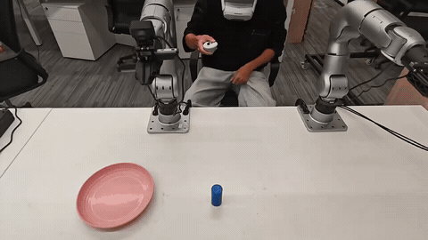
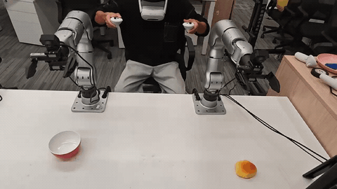
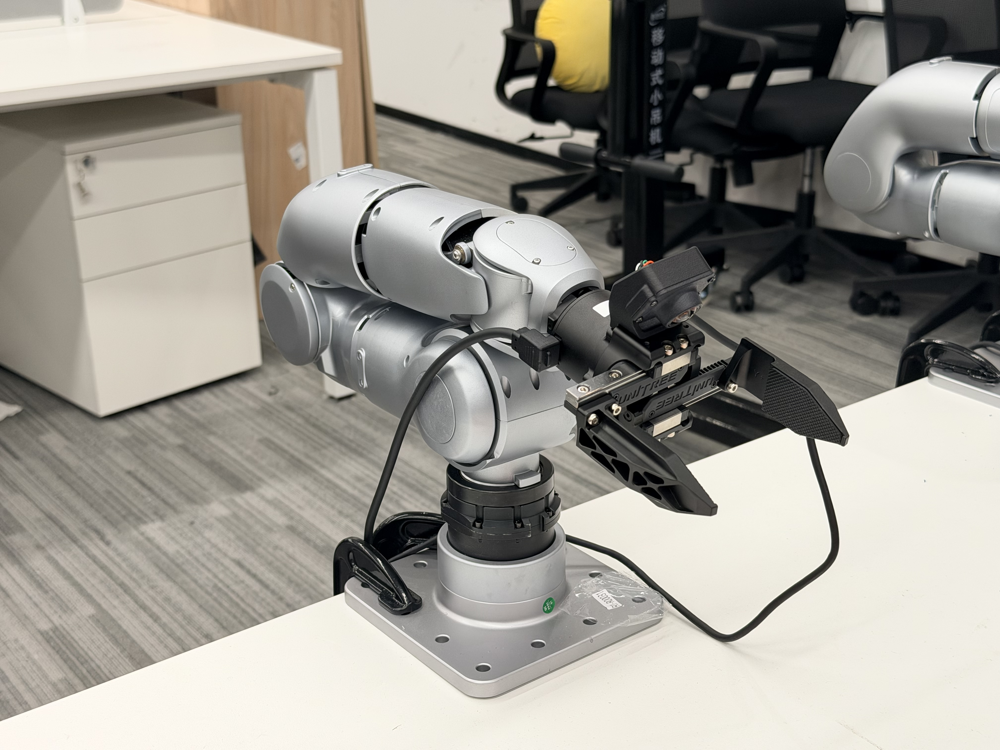
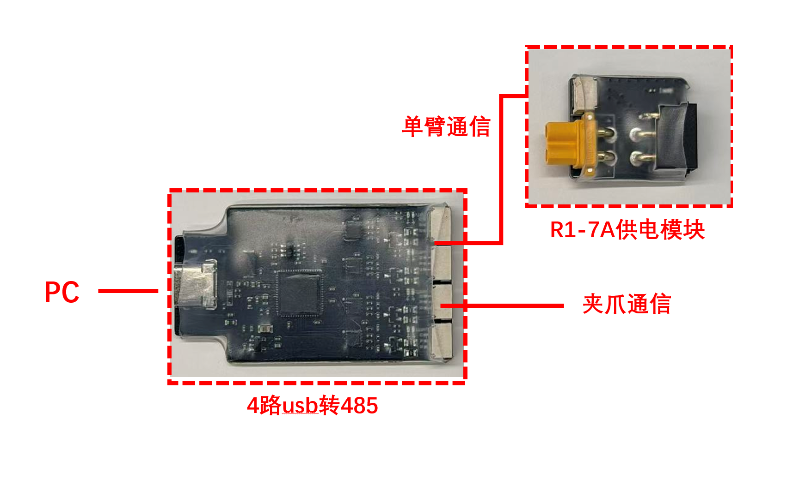
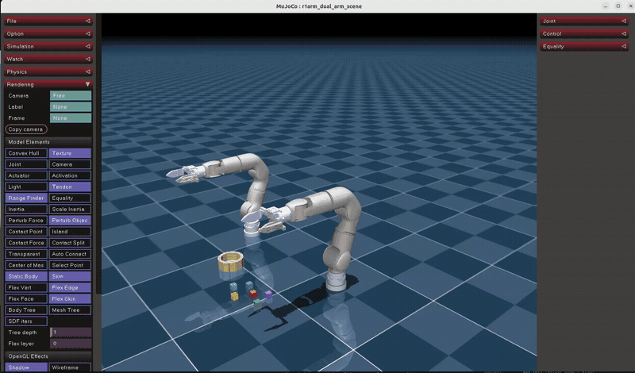
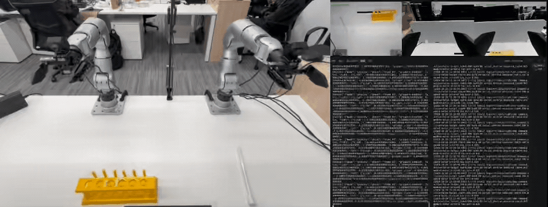

<div align="center">

**简体中文** | [English](README_en.md)

# R1-7A

**基于 PICO / XRoboToolkit 的七轴机械臂遥操作框架**

单臂 / 双臂遥操 · 多相机采集 · MCAP 录制与回放

[快速安装](#-配置环境) · [遥操作](#-遥操作) · [数据采集](#-数据采集) · [详细说明](detail.md)

</div>

| 单臂遥操作演示 · 01 | 双臂遥操作演示 · 02 |
|:---:|:---:|
|  |  |

## ✳️ 概述

R1-7A 遥操作框架通过 PICO 双手柄控制七轴机械臂与 Dex1 夹爪，支持单臂、双臂操作，以及图像和关节数据的同步采集。

- 🎮 **遥操作**：手柄相对位姿跟踪，左右机械臂和夹爪独立控制。
- 📦 **数据采集**：MCAP 记录控制目标、实测关节状态和多路相机图像。
- 🔄 **轨迹回放**：支持真机回放与 MuJoCo 仿真查看。

`硬件准备` → `配置环境` → `设备标定` → `遥操作与采集` → `轨迹回放`

## 🔧 硬件准备

<p align="center">
  
</p>

<p align="center">
  
</p>

| 设备 | 说明 |
|---|---|
| [R1-7A 七轴机械臂](https://www.unitree.com/R1-7a/) | 单臂一台，双臂两台；左右使用各自串口和标定 |
| [Dex1 夹爪](https://www.unitree.com/Dex1-1/) | 左右独立控制；无夹爪时可关闭 |
| PICO 头显与双手柄 | 运行 XRoboToolkit 客户端 |
| [4路USB转485模块](https://support.unitree.com/home/en/Motor_SDK_Dev_Guide/4-channel_485_to_USB_module) | 连接主机、机械臂与夹爪，各设备使用独立通道 |


> 真机启动前固定底座、可靠支撑机械臂，确认急停和归位路径净空。零增益探测期间不保持姿态；当前不提供双臂碰撞规划。

## 📥 配置环境

### 1. 克隆仓库

```bash
git clone --recurse-submodules https://github.com/unitreerobotics/R1-7A.git
cd R1-7A
```

### 2. 安装依赖

```bash
bash setup.sh
```

### 3. 配置 PICO

1. 电脑安装并启动 [XRoboToolkit PC Service](https://github.com/XR-Robotics/XRoboToolkit-PC-Service)。
2. PICO 安装 [XRoboToolkit 客户端](https://github.com/XR-Robotics/XRoboToolkit-Unity-Client)，连接电脑的局域网 IP。
3. 保持应用在前台，启用控制器数据发送，移动手柄确认数据持续更新。

安装选项、依赖版本及问题排查见 [详细安装说明](detail.md#-环境安装)。

## ⚙️ 设备配置与标定

首次运行需完成串口、左右机械臂标定和夹爪端点配置，保存为本机 `.env`。完整示例见 [设备配置与标定](detail.md#-设备配置与标定)。

四通道 FTDI 的参考接线：

| 右夹爪 | 右臂 | 左夹爪 | 左臂 |
|:---:|:---:|:---:|:---:|
| if00 | if01 | if02 | if03 |

按实际设备核对串口序列号与接线，左右臂使用各自的正确标定。已有匹配的原标定可直接使用；安装脚本不自动采集零位。

**每个终端从仓库根目录加载环境：**

```bash
conda activate r1_teleop
source .env
source scripts/real_env.sh
```

`r1_teleop` 为环境名，命令中的 `r1arm` 为当前代码路径。

## 🛠️ 遥操作

所有模式使用同一个入口 `scripts/teleop.py`，`--right`、`--left`、`--dual` 三选一。**加 `--record` 开启录制，不加时只遥操，不创建相机或录制文件。**

### 1. 终端一：启动对应夹爪

加载环境后，按所选模式运行一条命令并保持终端开启：

```bash
# 右臂
python -m dual.grippers --side right

# 左臂
python -m dual.grippers --side left

# 双臂
python -m dual.grippers --side both
```

确认所需侧均显示 `Detected motors` 和 `Gripper Server started`。

### 2. 终端二：启动遥操作

加载相同环境后，选择一条命令：

```bash
# 右臂
python scripts/teleop.py --right --motion-mode

# 左臂
python scripts/teleop.py --left --motion-mode

# 双臂
python scripts/teleop.py --dual --motion-mode
```

核对串口、标定和启动提示后输入 `MOVE`。所选机械臂默认平滑回 home，随后按住对应手柄 grip 开始跟踪。左臂自动使用左侧标定、方向转换与夹爪 topic，不要求右臂设备在线。

没有夹爪时跳过夹爪服务，并在命令后加 `--no-enable-dex1`。

### 3. 手柄操作

| 按键 | 行为 |
|---|---|
| 左 / 右 grip | 按住后对应机械臂跟踪手柄相对位姿 |
| 左 / 右 trigger | 控制对应夹爪闭合比例 |
| A（右手柄） | 所选机械臂回 home |
| X（左手柄） | 开启 `--record` 后，开始录制 / 停止并保存 |
| B（右手柄） | 录制期间暂停 / 恢复记录和跟踪 |
| Ctrl+C | 停止并退出，退出后继续支撑机械臂 |

单臂默认录制按键仍需要双手柄：X 在左手柄、A/B 在右手柄。

## 📦 数据采集

退出原遥操程序，保持对应夹爪服务运行，在同一入口加 `--record`：

```bash
# 右臂，默认头部与右腕相机
python scripts/teleop.py --right --record --motion-mode --output-dir data/right_real

# 左臂，默认头部与左腕相机
python scripts/teleop.py --left --record --motion-mode --output-dir data/left_real

# 双臂，默认头部与左右腕三路相机
python scripts/teleop.py --dual --record --motion-mode --output-dir data/dual_real
```

X 开始 / 保存，B 暂停 / 恢复。单臂输出 8 维、双臂输出 16 维 MCAP 数据，文件名为 `episode_0000.mcap` 等。真机控制目标频率 90 Hz、图像观测目标频率 30 Hz。

相机配置和检查命令见 [图像采集说明](detail.md#2-启用图像)。不录图像时加 `--no-cameras`：

```bash
python scripts/teleop.py --dual --record --motion-mode --no-cameras --output-dir data/dual_real
```

## 🔄 轨迹回放

先退出遥操和录制程序。只读检查不驱动电机：

```bash
python dual/replay.py --episode data/dual_real/episode_0000.mcap
```

确认数据和设备配置后，保留夹爪服务并执行真机回放：

```bash
python dual/replay.py --episode data/dual_real/episode_0000.mcap --motion-mode
```

回放不需要 PICO。单臂回放、慢放和图像预览见 [详细回放说明](detail.md#-轨迹回放)。

## 🧪 仿真

不连接真实机械臂，使用 mock 输入运行双臂仿真：

```bash
python scripts/teleop.py --sim --dual --mock-xr
```

检查真实 PICO 输入时去掉 `--mock-xr`；仿真同样支持 `--right`、`--left` 和 `--record`，使用 `python scripts/teleop.py --sim --help` 查看仿真参数。



## 🧑‍✈️ 主要参数

| 参数 | 默认值 |
|---|---|
| 控制目标频率 | 90 Hz |
| 电机 kp / kd | 60 / 10 |
| 最大关节速度 | 1 rad/s |
| 手柄位移比例 | 1.0 |
| home | `0,1.2,0,-1.2,0,0,0` rad |

完整参数使用各入口 `--help` 查看。设备配置、标定、数据格式和故障排查统一见 [detail.md](detail.md)。

## 🚀 训练与部署




## 🙏 致谢

感谢 [XRoboToolkit](https://github.com/XR-Robotics/XRoboToolkit-PC-Service)、[Placo](https://github.com/Rhoban/placo)、[MuJoCo](https://github.com/google-deepmind/mujoco) 以及 Unitree 相关 SDK 项目。

第三方依赖的许可遵循其原项目声明，当前根目录尚未提供 `LICENSE` 文件。
