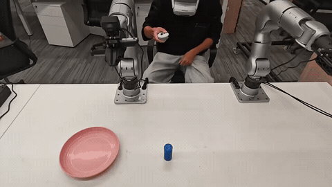
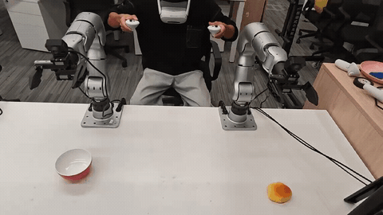
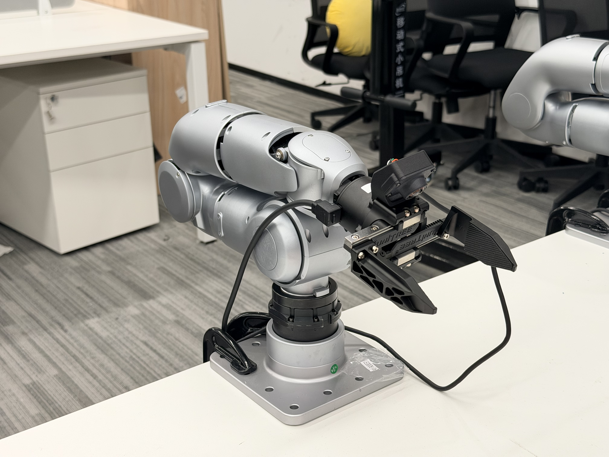
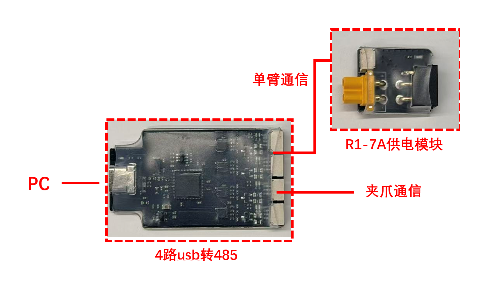
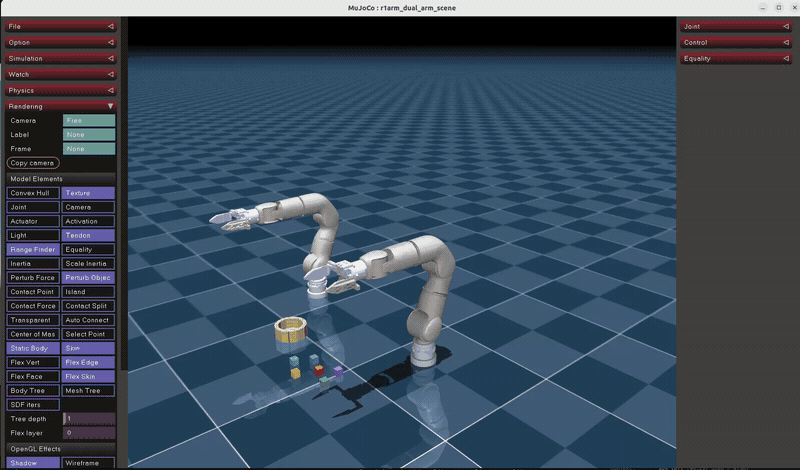
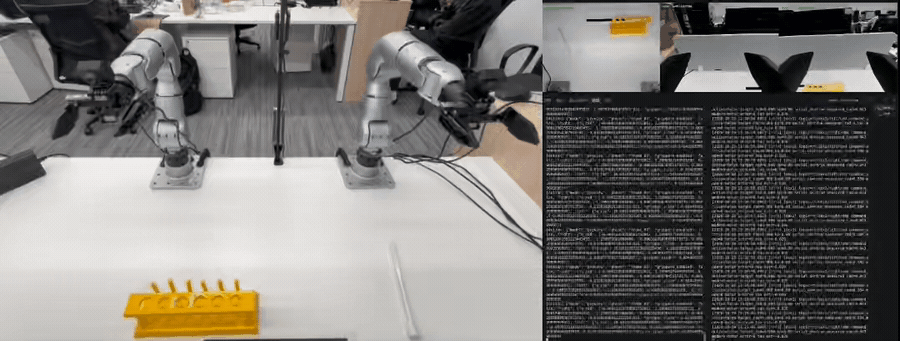

<div align="center">

[简体中文](README.md) | **English**

# R1-7A

**A 7-DoF robotic arm teleoperation framework powered by PICO / XRoboToolkit**

Single-arm / dual-arm teleoperation · Multi-camera capture · MCAP recording and replay

[Quick Setup](#-environment-setup) · [Teleoperation](#-teleoperation) · [Data Collection](#-data-collection) · [Detailed Guide (Chinese)](detail.md)

</div>

| Single-arm Teleoperation · 01 | Dual-arm Teleoperation · 02 |
|:---:|:---:|
|  |  |

## ✳️ Overview

The R1-7A teleoperation framework uses two PICO controllers to operate 7-DoF robotic arms and Dex1 grippers. It supports single-arm and dual-arm operation, along with camera and joint data collection.

- 🎮 **Teleoperation**: relative controller pose tracking with independent control of each arm and gripper.
- 📦 **Data Collection**: MCAP recordings of control targets, measured joint states, and multiple camera streams.
- 🔄 **Trajectory Replay**: replay on real hardware or inspect recordings in MuJoCo.

`Hardware Preparation` → `Environment Setup` → `Device Calibration` → `Teleoperation & Recording` → `Trajectory Replay`

## 🔧 Hardware Preparation

<p align="center">
  
</p>

<p align="center">
  
</p>

| Device | Description |
|---|---|
| [R1-7A 7-DoF robotic arm](https://www.unitree.com/R1-7a/) | One arm for single-arm operation or two for dual-arm operation; each uses its own serial port and calibration |
| [Dex1 gripper](https://www.unitree.com/Dex1-1/) | Independent left/right control; can be disabled when not installed |
| PICO headset and two controllers | Runs the XRoboToolkit client |
| Linux PC | Ubuntu 22.04, x86_64, with Git and Conda installed |
| [4-channel USB-to-RS485 module](https://support.unitree.com/home/en/Motor_SDK_Dev_Guide/4-channel_485_to_USB_module) | Connects the PC, arms, and grippers through separate channels |
| Cameras (optional) | RealSense or V4L2 / UVC cameras for image collection |

> Before operating real hardware, secure the arm bases, support the arms, and keep the emergency stop accessible and the homing paths clear. Zero-gain probing does not hold the arms in place. Dual-arm collision planning is not provided.

## 📥 Environment Setup

### 1. Clone the Repository

```bash
git clone --recurse-submodules https://github.com/unitreerobotics/R1-7A.git
cd R1-7A
```

### 2. Install Dependencies

Install all project dependencies and build the required components with one command:

```bash
bash setup.sh
```

### 3. Configure PICO

1. Install and start [XRoboToolkit PC Service](https://github.com/XR-Robotics/XRoboToolkit-PC-Service) on the PC.
2. Install the [XRoboToolkit client](https://github.com/XR-Robotics/XRoboToolkit-Unity-Client) on PICO and connect to the PC's local network IP address.
3. Keep the app in the foreground, enable controller data transmission, and move the controllers to confirm that data updates continuously.

For installation options, dependency versions, and troubleshooting, see the [detailed installation guide (Chinese)](detail.md#-环境安装).

## ⚙️ Device Configuration and Calibration

Before the first run, configure the serial ports, the calibration files for both arms, and the gripper endpoints. Save the machine-specific settings in `.env`. See the [configuration and calibration guide (Chinese)](detail.md#-设备配置与标定) for a complete example.

Reference wiring for the four-channel FTDI adapter:

| Right Gripper | Right Arm | Left Gripper | Left Arm |
|:---:|:---:|:---:|:---:|
| if00 | if01 | if02 | if03 |

Verify the adapter serial number and physical wiring, and use the correct calibration file for each arm. Existing calibration files can be reused if they match the physical devices and their current encoder references. The setup script does not capture zero positions automatically.

**Load the environment from the repository root in every terminal:**

```bash
conda activate r1_teleop
source .env
source scripts/real_env.sh
```

`r1_teleop` is the Conda environment name. The `r1arm` names in commands are the existing code paths.

## 🛠️ Teleoperation

Use a single entry point, `scripts/teleop.py`, and select exactly one of `--right`, `--left`, or `--dual`. **Add `--record` to enable recording. Without it, no recorder, cameras, or recording files are created.**

### 1. Terminal 1: Start the Selected Gripper Services

Load the environment, select one command, and keep this terminal open:

```bash
# Right arm
python -m dual.grippers --side right

# Left arm
python -m dual.grippers --side left

# Both arms
python -m dual.grippers --side both
```

Confirm that each required side reports `Detected motors` and `Gripper Server started`.

### 2. Terminal 2: Start Teleoperation

Load the same environment and select one command:

```bash
# Right arm
python scripts/teleop.py --right --motion-mode

# Left arm
python scripts/teleop.py --left --motion-mode

# Both arms
python scripts/teleop.py --dual --motion-mode
```

Check the ports, calibration files, and startup messages before typing `MOVE`. The selected arms move smoothly to home by default. Hold the corresponding grip button to start tracking after homing. Left-arm mode uses the left calibration, coordinate transform, and gripper topic without requiring right-arm hardware.

If no grippers are installed, skip the gripper services and add `--no-enable-dex1`.

### 3. Controller Buttons

| Input | Behavior |
|---|---|
| Left / right grip | Hold to track the corresponding controller's relative pose |
| Left / right trigger | Controls the corresponding gripper's closing ratio |
| A (right controller) | Return the selected arms to home |
| X (left controller) | With `--record`: start recording / stop and save |
| B (right controller) | Pause / resume recording and tracking during an active recording |
| Ctrl+C | Stop and exit; continue supporting the arms after exit |

Default recording controls still use both controllers in single-arm mode: X is on the left controller, and A/B are on the right.

## 📦 Data Collection

Exit the existing teleoperation program, keep the selected gripper services running, and add `--record` to the same entry point:

```bash
# Right arm: head and right-wrist cameras by default
python scripts/teleop.py --right --record --motion-mode --output-dir data/right_real

# Left arm: head and left-wrist cameras by default
python scripts/teleop.py --left --record --motion-mode --output-dir data/left_real

# Both arms: head and both wrist cameras by default
python scripts/teleop.py --dual --record --motion-mode --output-dir data/dual_real
```

Press X to start / save and B to pause / resume. MCAP vectors contain 8 values in single-arm mode and 16 in dual-arm mode. Files are named `episode_0000.mcap`, etc. Real-hardware target rates are 90 Hz for control and 30 Hz for image observations.

See the [image collection guide (Chinese)](detail.md#2-启用图像) for camera configuration. Add `--no-cameras` to record without images:

```bash
python scripts/teleop.py --dual --record --motion-mode --no-cameras --output-dir data/dual_real
```

## 🔄 Trajectory Replay

Exit teleoperation and recording programs first. A read-only check does not drive the motors:

```bash
python dual/replay.py --episode data/dual_real/episode_0000.mcap
```

After checking the data and device configuration, keep the gripper services running and replay on real hardware:

```bash
python dual/replay.py --episode data/dual_real/episode_0000.mcap --motion-mode
```

Replay does not require PICO. For single-arm replay, slower playback, and image previews, see the [detailed replay guide (Chinese)](detail.md#-轨迹回放).

## 🧪 Simulation

Run dual-arm simulation with mock input, without connecting to real arms:

```bash
python scripts/teleop.py --sim --dual --mock-xr
```

Remove `--mock-xr` to test real PICO input. Simulation also supports `--right`, `--left`, and `--record`; use `python scripts/teleop.py --sim --help` for simulation options.



## 🧑‍✈️ Key Parameters

| Parameter | Default |
|---|---|
| Target control rate | 90 Hz |
| Motor kp / kd | 60 / 10 |
| Maximum joint speed | 1 rad/s |
| Controller translation scale | 1.0 |
| Home | `0,1.2,0,-1.2,0,0,0` rad |

Use `--help` on each entry point for the full parameter list. Device configuration, calibration, data formats, and troubleshooting are covered in [detail.md (Chinese)](detail.md).

## 🧠 Training

## 🚀 Deployment



## 🙏 Acknowledgments

Thanks to [XRoboToolkit](https://github.com/XR-Robotics/XRoboToolkit-PC-Service), [Placo](https://github.com/Rhoban/placo), [MuJoCo](https://github.com/google-deepmind/mujoco), and the related Unitree SDK projects.

The page structure is inspired by [UniArmL1](https://github.com/unitreerobotics/UniArmL1). Third-party dependencies retain their original licenses. This repository does not currently include a root-level `LICENSE` file.
